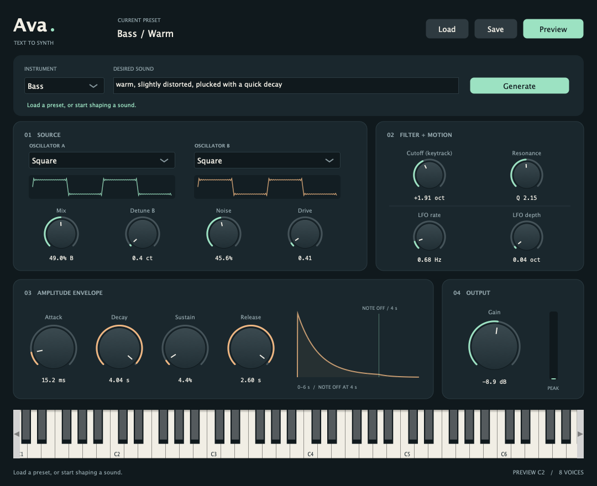

# Ava — C++ plugin

Ava turns text descriptions into playable, editable synth presets. This is the
C++17 synthesis engine, JUCE interface and native ONNX inference code.
The current build targets Apple Silicon Macs and produces Audio Unit, VST3 and
standalone versions.

[Read the blog](https://gisilvs.github.io/blog/ava/) ·
[PyTorch synth and training](https://github.com/gisilvs/ava-torch)



## Build

Install Apple's Command Line Tools (`xcode-select --install`) and Python 3.
Then, from this repository:

```bash
bash scripts/build_plugin.sh
```

The script downloads pinned JUCE and ONNX Runtime dependencies, builds with one
job to limit memory, signs the bundles ad hoc and runs the DSP and plugin checks.
Python only sets up CMake; the installed plugin does not use it.

The final trained mapper is included in `models/mapper/` and copied into each
bundle. It matches `weights/text_audio.pt` in ava-torch: the 442k-parameter model
trained from scratch on text-generated data, selected at epoch 197. Source
checkpoint and export hashes are recorded alongside the model.

Outputs are under `build/plugin/Ava_artefacts/Release/`:

- `Standalone/Ava.app`
- `AU/Ava.component`
- `VST3/Ava.vst3`

```bash
open build/plugin/Ava_artefacts/Release/Standalone/Ava.app
```

You can play and tweak the synth immediately. Text generation also needs the
larger generator bundle described below. There is no external inference service.

## Enable text generation and install

Clone [ava-torch](https://github.com/gisilvs/ava-torch) next to this repository.
Follow its installation instructions, obtain access to the upstream Stable Audio
model, then export the generator:

```bash
cd ../ava-torch
python -m export.export_generator stage=text
python -m export.export_generator stage=verify-text
python -m export.export_generator stage=denoiser
python -m export.export_generator stage=verify-denoiser
python -m export.export_generator stage=quantize
cd ../ava-cpp
```

This creates `../ava-torch/outputs/generator_int8/`, containing the INT8 text
encoder, latent generator, tokenizer and eight-step sampling settings. The full
bundle is about 1.3 GB; it is not stored in Git. The reference settings and
checksums in `models/generator/` identify the export used for the blog. Exports
from other dependency or model versions may have different hashes.

Quit Logic and install the AU and generator:

```bash
bash scripts/install_au.sh
```

Reopen Logic and load Ava as an instrument. If necessary, rescan it in Plug-in
Manager. Choose an instrument, enter an optional description and press Generate.
A successful generation replaces the current preset. Cancel keeps the previous
sound. Play with MIDI or the on-screen keyboard; Load/Save stores editable JSON
presets. Examples are in `examples/`.

To install all three formats, first create a package:

```bash
bash scripts/package_macos.sh
bash build/release/Ava-0.1.0-macos-arm64/install.sh
```

The package contains the plugins, generator, presets and installer. It needs no
Python or model downloads on the destination Mac. It installs into the user's
Applications and Library folders, backing up previous versions. These are ad-hoc
signed builds, not notarized installers; another Mac may require manual approval
in macOS security settings. See [package instructions](docs/macos_package.md).

To use your own exports, set `AVA_MAPPER_DIR` for the build and
`AVA_GENERATOR_ASSETS` for installation or packaging. The mapper and generator
must use the same latent space. Do not put the audio decoder or pitch tracker in
the plugin: they are only needed to prepare training data.

## Code

- `dsp/`: oscillators, ADSR, resonant filter, LFO, noise, drive and voices.
  Independent of JUCE and ONNX; see the [DSP guide](dsp/README.md).
- `plugin/`: JUCE processor, interface, MIDI, host-rate conversion and presets.
- `inference/`: ONNX mapper, tokenizer and latent generator. Generation runs in a
  helper process; inference never runs on the real-time audio thread.
- `scripts/`: dependency setup, build, checks, installation and packaging.
- `tests/`: DSP and plugin checks.
- `web/`: a small WebAssembly bridge to the same DSP, used by the blog demo.

The learned synth runs at 24 kHz; the plugin resamples to the host's rate.
It has eight voices, sustain pedal and pitch bend. Gain is not a peak limiter:
resonance and polyphony can exceed 0 dBFS. Presets use the versioned `synth_v1`
control mapping shared with ava-torch.

The DSP alone needs just a C++ compiler:

```bash
bash scripts/test_dsp.sh
```

## Model and dependency terms

JUCE and ONNX Runtime retain their own licenses. The setup scripts download them
rather than vendoring them. Stable Audio's generator and its Gemma-based text
encoder have separate terms; see
[Stable Audio's license](https://huggingface.co/stabilityai/stable-audio-3-small-sfx/blob/main/LICENSE.md)
and the [Gemma terms](https://ai.google.dev/gemma/terms). Obtain the model through
its official Hugging Face repository before exporting. Check those terms before
redistributing a package containing the generator.
